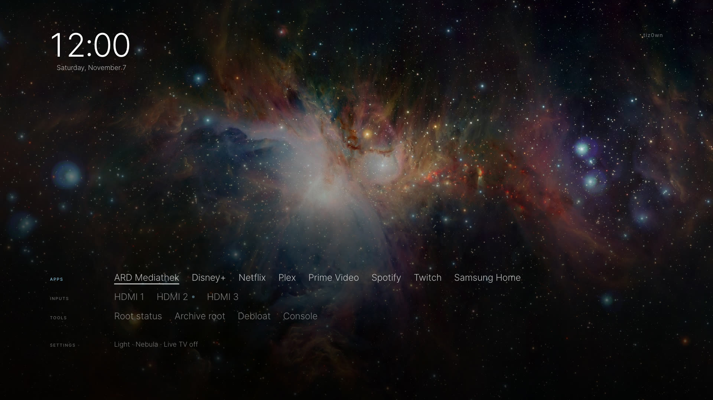

# tiz0wn

An evidence-first security research workspace for a personally owned Samsung
Q60T (`GQ55Q60TGUXZG`, firmware `T-NKLDEUC-2743.0`).
_Claude was used to polish and proof-read the code and documentation of this repository._

## Progress

- **2026-11-04** — app route: root from the installed app, boot persistence,
  token relay.
- **2026-11-05** — reversible debloating across the package and unit classes,
  each target trialled over a reboot and reverted.
- **2026-11-07** — a new TV menu for the app: a typographic home and tools page,
  verified on the set. It lists the installed apps and HDMI inputs and runs over
  the live HDMI picture. Pointing the Home key at it is blocked on this
  firmware; see [the Home-key plan](docs/home-key-menu-plan.md).

Operating detail: `docs/current-state-2026-11-04.md`.

## TV menu



The app's home is a typographic index: one row each for apps, inputs, tools and
settings, labelled in a narrow left column. The focused item is white and
underlined, and the active row's label turns blue. Typeset in Inter.
[`docs/ui-system.md`](docs/ui-system.md) is the design contract.
[`docs/screenshots/home-menu-2026-11-07/`](docs/screenshots/home-menu-2026-11-07/)
has the full set: home, tools, the band over a live picture and over a white
frame, at 1080p and 720p. `exploits/tiz0wn-app/tests/shots/shoot.sh` renders
them again.

What was verified on the Q60T (2026-11-07):

- **Real data.** Home lists the installed apps and HDMI inputs and launches them.
  This needs the packaged app origin: the loopback page origin
  (`http://127.0.0.1:18735`) gets no `tizen` API at all. The tools and the
  probe page stay on loopback because the root service accepts only that origin.
- **Live picture.** Settings → Live TV, or the band (Opens to → Band), keeps the
  HDMI picture playing behind the transparent page. The band's lower third keeps
  every text tone at 4.5:1 contrast or better over a white frame; a test checks it.
- **Smooth on Chromium 69.** Moving between rows had made the background photo
  flicker. Two changes fixed it: no per-item opacity transitions, and the
  active-row class set on the index instead of `<html>`.
- **Home key: not remapped.** Both pieces of the Tizen 6.5 method are missing on
  Tizen 5.5: the `db/appfw/home_appid` key, and `aul_get_default_app` in
  `libaul.so.0`. The safety chain refused to save a baseline, so nothing on the
  TV's Home routing changed. Details and the offline-tested guard and trial
  tooling are in [`docs/home-key-menu-plan.md`](docs/home-key-menu-plan.md).

<details>
<summary>Status and limitations</summary>

> [!NOTE]
> tiz0wn is an independent exploratory security research project. Developed
> independently alongside my main professional work. The code and write-ups
> are references for investigation and adaptation, rather than a ready-to-use
> rooting product. Recorded results cover one owned Q60T and an exact firmware
> build; sibling-model values and offsets are not interchangeable.
>
> **Disclaimer.** Findings do not guarantee the security, compatibility or
> recoverability of another device. Use only systems you own or are authorized
> to test. Root access and persistent filesystem changes can cause data loss,
> outages or an unusable device; validate the documented gates and recovery
> path before proceeding. You are responsible for any changes you make.

</details>

Scope: one device and one exact build. Everything below was measured on that
unit, including the offsets. Sibling models are discussed where the work
overlaps, and their values are theirs, not portable here.

The project began as reversible debloating. Firmware analysis then exposed a
shorter path: Remote PC writes user-controlled SMB credentials, the privileged
CIFS helper substitutes them into a shell command, and the shipped script
executes that command as root. A live validation on 2026-09-27 proved that with
only:

```text
$(/usr/bin/id>/tmp/<fresh-marker>)
```

The follow-up in [`exploits/tiz0wn-root/`](exploits/tiz0wn-root/) took
the same trigger further: one click to a root shell that survives reboots. A
same-size block patch in the read-only rootfs is hash-gated, backed up, written
and re-verified, and a boot hook fires it once per boot. `sdk` was also turned
into a root login. Three full power cycles confirmed the persistence.

The measured password-field characters and limits are in the
[trigger grammar](docs/trigger-grammar.md).

Read [the report](docs/DISCLOSURE.md) for the source trace and the reproduction
notes.
## Current results

| Area | Result |
|---|---|
| Reversible debloating | Inventory and one-change-at-a-time tooling; no bulk uninstall list |
| Firmware analysis | The exact 2743.0 image decrypted and statically examined; no firmware redistributed |
| Remote PC/CIFS | Command injection through the password field, executed as UID 0 |
| One-shot exploit | Complete and live. One trigger writes a same-size block patch in the read-only rootfs, verifies it by re-read, backs up the vendor bytes and installs a root agent |
| Persistence | Proven over three full power cycles; the hook fires once per boot as `uid=0` and restores the agent |
| `sdk` as root login | Done. `sdk` resolves to `uid 0` with `/root` and `/bin/bash` and a password, surviving power cycles, with no mode loosened |
| Root capability | Root over the whole filesystem, block devices, `/proc` and sysctl, but no unsigned binary executes (see below) |
| App route | **Live root and boot persistence**: `/root` returns `rc=0`, `amd` starts the service from the per-user `app_onboot` row at every boot, and `POST /cmd` runs bounded root commands |
| UEP disable | The kernel state word is mapped offline; the physical primitive and write are unproven |
| Debloat adoption | 29 packages classified, reversible `pkgcmd`, quick settings, kill-switch map and hosts filter prepared |

The chain needs one trigger, no USB stick, no kernel exploit, no kernel module
and no UEP patch. The full procedure, measurements and limits are in
[`exploits/tiz0wn-root/LIVE-RUN-2026-10-29.md`](exploits/tiz0wn-root/LIVE-RUN-2026-10-29.md).

UEP is not a privilege boundary. Measured as `uid=0`: a copy of bash on tmpfs is
refused with `EPERM` and `[uep][bash] the file is NOT signed!!`. The verdict is a
signature check bound to the **inode**, not to a path or to the bytes: a
byte-identical copy of a signed binary is refused too. One kernel handler covers
`execve` and `PROT_EXEC` mappings, and the shells gate script *paths* separately
through `libkUEPUser`. Neither half is lifted by privilege, so no unsigned binary
runs and every step is a script invoked by content via `sh -c "$(cat …)"`.
Dropbear, custom tooling as processes and kernel modules are therefore
unavailable even as root.

`make -C exploits/tiz0wn-root check` lints the shell and Python and runs the
loopback rehearsal, without contacting the TV. The ledger and handoff notes are
local-only and untracked; the synthetic tests and security controls are public,
so a clone can run them.

## Three routes, one community effort

Three people reached root on this TV generation within weeks of each other, on
three models, and published what they learned. Nobody started from nothing:
each route borrows a piece the others proved. The routes are complementary
rather than competing: each solves a different problem and each has a weak half
the others do not. Since publication a fourth set joined the effort: on a
Q74T the same CIFS path reached a persistent root agent, and its owner
supplied the two platform gotchas below that matter for anyone building on
this family.

| | [metaljay](https://github.com/metaljay) (Q90T) | [cfloinc](https://github.com/cfloinc/samsung-q70t-tizen-root) (Q70T) | this repo (`GQ55Q60TGUXZG`) |
|---|---|---|---|
| Entry | USB image, via [Luminger/samsung-tv-usb-root](https://github.com/Luminger/samsung-tv-usb-root), after kernel work | exFAT kernel LPE from a USB stick | Remote PC credential sink, network only |
| Privilege step | kernel patch plus per-image addresses | kernel exploit | none; the vendor's own root `bash -c` |
| Persistence | `profile.d` single-block swap | `profile.d` single-block swap | same mechanism, plus a hash-gated whole-window check |
| Rollback | needs the USB stick or the dossier | needs the stick or a second run | another trigger; the backup hashes to the vendor image |
| Reach | physical USB port | physical USB port | the TV's own network, one password field |
| UEP | derived the gates but shipped content-form per hop, since a verifier-entry patch boot-looped | chose the signed-`/bin/bash` variant rather than patch UEP; content-form for the hook | never touched; content-form throughout |

Coverage so far, one verified build per row: offsets are per-image and never
transfer, but the 776-byte carrier is byte-identical on every set, which is
what makes the comparison meaningful. These rows are the working state of
issue #1's *Q-Series Coverage & Affected-Version Matrix* milestone: confirmed
roots per exact build, not a claimed affected range.

| Set (model, build) | Route to root | Persistence offset | Verified on the set |
|---|---|---|---|
| Q60T `GQ55Q60TGUXZG`, `T-NKLDEUC-2743.0` | Remote PC/CIFS credential sink | p19 byte `704753664` | three full power cycles; `sdk` root login |
| Q90T `QE75Q90TATXXU`, `T-NKMDEUC-REL-202607031800` | USB image (Luminger), after two bounded CIFS UID-0 proofs | p18 byte `752541696` (512-block `1469808`) | USB-free boots via boot IDs; set planned back to stock |
| Q70T `QN65Q70TAFXZA`, `T-NKMAKUC-2743.0` | exFAT USB kernel LPE after the SDB foothold | p19 byte `1612972032` (512-block `3150336`) | two power cycles; dropbear root SSH |
| Q74T `QE55Q74TATXZT`, `T-NKMDEUC-2743.0` (Tizen 5.5) | Remote PC/CIFS, via the [vetro remote-pc prototype](https://github.com/andrearicci93/vetro) | derived from its own image | persistence and the agent's loopback channel after the two fixes below |

Read together, the three cover each other's gaps. The USB routes work on a set
with no network path and no Developer Mode. This route works with no stick, no
kernel primitive and no image, but needs the Remote PC feature reachable. The
kernel work documents the UEP gates and how to disable them, which this route
avoids needing. None of the three is a superset, and a reader landing on any of
them should know the others exist.

One difference the Reach row hides: the entry is not the whole surface. cfloinc's
chain ends by firing the kernel stage from a loop device at ~60 s, so UEP is down
at boot and dropbear serves root SSH on `:22` — a booted set is reachable over
the network. On the TV, this route adds no network listener: `cmd/in` is `0777`, so anything
already local at `sdk` can drive root, and nothing else can. Keeping UEP armed is
what that costs; an agent instead of a listener.

What all three converged on, independently, is the persistence primitive: a
776-byte `/etc/profile.d/bash_prompt_custom.sh` replaced in place with a
same-size block write at a per-image offset, backed up byte-exactly, and
reached through `tizen-system-env.service` → `/etc/profile` → `profile.d`. The
method is portable and the offset is not; the matrix above points at each
derivation instead of restating it.

The sharpest shared finding is that root alone is not enough, because of UEP.
cfloinc and metaljay each hit it on their own set — the file-loading no-op and
the verifier/global boot loop are better read in their own words than retold
here. This repo measured the consequence directly as `uid=0`: an unsigned ELF on
tmpfs returns `EPERM` and `the file is NOT signed!!`, and a byte-identical copy
of a signed binary is refused as well, which is the evidence for the inode
binding. UEP is independent of privilege, so being root does not let you run a
single unsigned binary. No dropbear, no custom tooling as a process, no kernel
modules.

The inode model, and the split between the kernel handler (`execve`,
`PROT_EXEC`) and the user-space shell gate for script paths, are txtsamu's T6500
correction. cfloinc flags them as such and marks his own Q70T controls for the
shell layer as still queued, so the two are kept apart here as well.

Two further platform traps were found by tenda96 on the Q74T rather than here:
the content rule also applies one level deeper (a helper started by path from a
content-invoked hook is silently refused, which is why this chain's helper
start is content too), and SMACK denies a `_`-labelled root agent's loopback
`connect()` to an app-labelled socket. The second is shipped as
[`payload/smack-allow`](exploits/tiz0wn-root/payload/smack-allow); his issue #1
comment carries the raw evidence.

That is why this chain keeps UEP armed end to end and pays for it only in style:
every step is a script invoked by content. Where UEP is disabled, the kernel work
above already documents how, and its symbols are the reference for the family.

## Attribution

These routes are one effort, and the sections below are theirs to write.
Thanks to all three, and to everyone in issue #1 who tested, corrected and
cross-checked:

- [metaljay](https://github.com/metaljay), first public root on this generation;
  the Q90T `profile.d` offset and the reusable shape of the method (same-size
  swap, byte-exact backup, one-command rollback); the kernel symbol table; the
  correction that `kill -47` is halt rather than reboot; and the correction that
  the REL build stamp, not the `2743.0` string, is the firm identifier. Also
  reviewed the compatibility wording.
- [cfloinc](https://github.com/cfloinc/samsung-q70t-tizen-root), the Q70T writeup
  and `persistent-hook/` kit (MIT); the UEP file-loading finding that `sh -c
  "$(cat …)"` exists to defeat; the independent cross-check of the NIKEM kernel
  symbol table from the Q70T kernel via the SWU TrustZone TA; the negative
  result that archive-root is impossible without `/usr/bin/dotnet`; and the
  attribution that keeps the per-inode UEP model with txtsamu rather than
  folding it into the Q70T work.
- [tenda96](https://github.com/tenda96), the fourth NIKEM-family cross-check on
  a Q74T (`QE55Q74TATXZT`): the carrier byte-identity confirmed on a fourth set
  with the offset derived from his own image; the finding that the
  content-invocation rule applies recursively, so a helper started by path from
  a content-invoked hook is silently refused by UEP; and the finding that a
  `_`-labelled root agent is denied loopback TCP to app-labelled sockets unless
  explicit SMACK `load2` rules are loaded both ways. Both findings stand behind
  the persistent root agent on the [vetro remote-pc prototype](https://github.com/andrearicci93/vetro)
  on that set.

`NOTICE.md` keeps the used-versus-investigated distinction and the licenses.
Where a technique here is theirs, the credit sits on the technique rather than
only in this section.

The sections below are for the people who did the work, and they keep their own
words. cfloinc sent his text for the README (issue #1, 29 October) and it is
reproduced verbatim. metaljay and tenda96 have not sent theirs yet, so those two
sections point at their own reports instead of paraphrasing them and will be
replaced when the text arrives.

## From cfloinc (Q70T)
As sent in [issue #1](https://github.com/sebastianspicker/tiz0wn/issues/1#issuecomment-6504466699)
on 29 October:

> **QN65Q70TAFXZA (2020 Q70T, NIKEM, Tizen 6.0, kernel 4.1.10, `T-NKMAKUC-2743.0`).** No `/usr/bin/dotnet` host, so archive-root is not applicable; root came from the exFAT USB kernel LPE after the SDB foothold, then a 776-byte in-place `profile.d` patch (same-size replacement, per-image block offset) made it stick. Every hop passes script content (`sh -c "$(cat …)"`) because UEP gates script file loading; the boot hook runs at ~0.73 s, applies 13 runtime masks, fires UEP down from a loop device at ~60 s, and starts dropbear root SSH. Details: https://github.com/cfloinc/samsung-q70t-tizen-root

What is not transferable to the Q60T, in his own terms and confirmed here: the
offset (`1612972032` on p19 there, `704753664` on p19 here) and the dotnet host
question. What carried over is the content form and the block surgery, both used
in this chain. The loop-device UEP-down half did not carry over: on the Q60T UEP
stays armed and the reach is local, not `:22`.

## From metaljay (Q90T)

**QE75Q90TATXXU, build stamp `T-NKMDEUC-REL-202607031800`.** His CIFS UID-0
proofs, the USB root chain, the p18 offset and the kernel symbols are in his
[issue #1](https://github.com/sebastianspicker/tiz0wn/issues/1) reports of
13, 20, 21 and 28 October, and in the handover those link. This section stays a
pointer until he sends the short text he offered.

## From tenda96 (Q74T)

**QE55Q74TATXZT, `T-NKMDEUC-2743.0`.** Fourth NIKEM-family set. His
[issue #1 comment](https://github.com/sebastianspicker/tiz0wn/issues/1#issuecomment-6590976026)
of 2 November carries the carrier cross-check and the two traps named above;
the work was done on the
[vetro remote-pc prototype](https://github.com/andrearicci93/vetro). Pointer
until he offers his own text.

## Running it

`make -C exploits/tiz0wn-root check` lints the shell and Python and runs the
loopback rehearsal on a block file. Nothing contacts the TV.

A run follows `plan` → `build-run` → `check` offline, then `serve` on a specific
private IPv4 address and a port from 1 to 65535. The account is off by default;
enabling it requires `--account` together with `--password`. The
[runbook](exploits/tiz0wn-root/README.md#using-it-offline) has the commands and
the verified rollback path for a live trigger.

A live run needs the offset from your own image and one Remote PC trigger. The
procedure, gates and limits are in
[`LIVE-RUN-2026-10-29.md`](exploits/tiz0wn-root/LIVE-RUN-2026-10-29.md). Do not
use it on a device you do not own, and do not expose RDP, SMB, SDB or the
TV-control port to the Internet.

## Repository map

| Path | Purpose |
|---|---|
| [`docs/ARCHITECTURE.md`](docs/ARCHITECTURE.md) | What runs where, the two user journeys and the boot path, as diagrams |
| [`exploits/tiz0wn-root/`](exploits/tiz0wn-root/) | The chain: builder, payloads, session tooling |
| [`exploits/tiz0wn-app/`](exploits/tiz0wn-app/) | Self-signed app route: local SDB, archive launcher, UEP control; offline-tested |
| [`exploits/tiz0wn-root/LIVE-RUN-2026-11-04.md`](exploits/tiz0wn-root/LIVE-RUN-2026-11-04.md) | The app-local SDB root run and its exact requirements |
| [`exploits/tiz0wn-root/LIVE-RUN-2026-10-29.md`](exploits/tiz0wn-root/LIVE-RUN-2026-10-29.md) | The live session: offset derivation, trigger, verification, boot proofs |
| [`exploits/tiz0wn-root/builder/accounts.py`](exploits/tiz0wn-root/builder/accounts.py) | The `sdk` and `shadow` patch: builder and gates |
| [`exploits/tiz0wn-root/payload/rootlogin`](exploits/tiz0wn-root/payload/rootlogin) | The same patch as a device script |
| [`exploits/tiz0wn-root/HANDOFF-SAMSUNG.md`](exploits/tiz0wn-root/HANDOFF-SAMSUNG.md) | Vendor-facing summary |
| [`docs/app-route-report.md`](docs/app-route-report.md) | Batch report: app route, UEP map, primitive audit and debloat adoption |
| [`docs/app-persistence-design.md`](docs/app-persistence-design.md) | Prebuilt archive and agent-controlled boot-start design |
| [`docs/ui-system.md`](docs/ui-system.md) | The TV menu's design contract: tokens, typography, focus, band |
| [`docs/home-key-menu-plan.md`](docs/home-key-menu-plan.md) | The Home-key menu plan, its TV findings and why the remap is blocked |
| [`docs/screenshots/home-menu-2026-11-07/`](docs/screenshots/home-menu-2026-11-07/) | Rendered screenshots of the menu at 1080p and 720p |
| [`docs/DISCLOSURE.md`](docs/DISCLOSURE.md) | The vulnerability report, timeline and fix guidance |
| [`docs/uep-q60t.md`](docs/uep-q60t.md) | The guarded UEP state word, addresses and live-check sequence |
| [`docs/physical-primitives.md`](docs/physical-primitives.md) | The physical-memory candidate audit |
| [`docs/archive-root-prereqs.md`](docs/archive-root-prereqs.md) | Which archive-chain components exist on this build |
| [`docs/debloat-q60t.md`](docs/debloat-q60t.md) | Offline background-package inventory and roles |
| [`docs/firmware-analysis.md`](docs/firmware-analysis.md) | The image analysis the offset comes from |
| [`docs/trigger-grammar.md`](docs/trigger-grammar.md) | The measured password-field character classes, proven and rejected |
| [`docs/privileged-services.md`](docs/privileged-services.md) | The privileged-service inventory: shell-argv versus argv-direct sinks |
| [`docs/testing.md`](docs/testing.md) | What the public suites cover, what stays local |
| [`SECURITY.md`](SECURITY.md) | Reporting, what is public, how to run it safely |

## Roadmap

- **Liquid-glass TV UI** — future milestone: replace the whole TV UI (home,
  sources, apps, settings, now-playing, OSD) with a minimalist, high-craft
  surface in a 2026 Apple TV idiom, including boot and HOME takeover. The app's
  home and tools pages are done and verified (see [TV menu](#tv-menu)). HOME
  takeover is blocked on Tizen 5.5 until the set's own `XF86Home` routing is
  measured; see `docs/home-key-menu-plan.md`.
  Constraints, hard problems, phases and acceptance:
  `docs/milestone-liquid-glass-ui.md`. Reference for interaction ideas only:
  `wingedpanther/cleanmytv`.
- Bridge supervision and a `/cmd`-based maintenance path, so routine work never
  needs an `sdb` session.
- Re-apply checklist and cold-boot drill after an OTA.

## Safety and scope

- Own device, trusted local network, explicit target only.
- Measure first; make one reversible change at a time.
- Treat IP addresses, DUID/device IDs, tokens, and raw evidence as private.
- Never infer a firmware range from one verified build.
- Do not confuse the disposable RDP host's `q60t` account with the TV's `sdk`.
- Nothing is written before the window hash matches, and the backup is verified
  before it is needed.
- The app route is a self-signed development package. A self-signed author
  certificate is not a store certificate and does not establish boot startup.
- UEP and app-route root are volatile; a reboot clears them. Keep the CIFS route
  as recovery.

## License

MIT; see [`LICENSE`](LICENSE). Firmware and third-party tools are not
redistributed. Their attribution and licensing are described in
[`NOTICE.md`](NOTICE.md).

## Tooling security checks

GitHub runs synthetic offline security controls; CodeQL default setup is
configured for Python. General shell/Python lint runs manually or for
Dependabot-authored pull requests. The workflow never contacts a TV,
starts a delivery server on the LAN, deploys a payload or publishes a release.
Action versions are tracked by Dependabot. Detailed field suites and device
evidence remain local.

Generated shadow-table windows and baked setup/resume scripts are atomically
written with owner-only permissions. The optional host callback receiver now
binds the explicit `HOST_IP`, accepts only the configured `TV_HOST` source IPv4,
requires the per-call token that `q.sh` generated, and limits a response to
16 MiB, 10 seconds of idle time and 35 seconds total (including at most 25
seconds waiting for the peer). It publishes only complete output, mode 0600.
Wrong-peer, wrong-token, oversized and timed-out callbacks leave existing
output unchanged. The `q.sh` caller passes these addresses explicitly and stops
if its receiver fails.

The address filter and per-call token are not cryptographic authentication;
base64 is not encryption. Use an isolated, trusted lab network. These limits are
not evidence of broader model or firmware compatibility, and no live target was
used by the CI checks.
